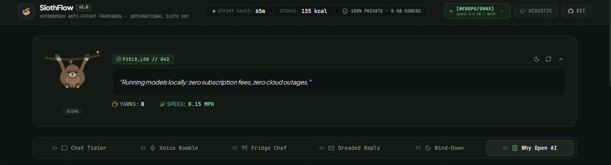
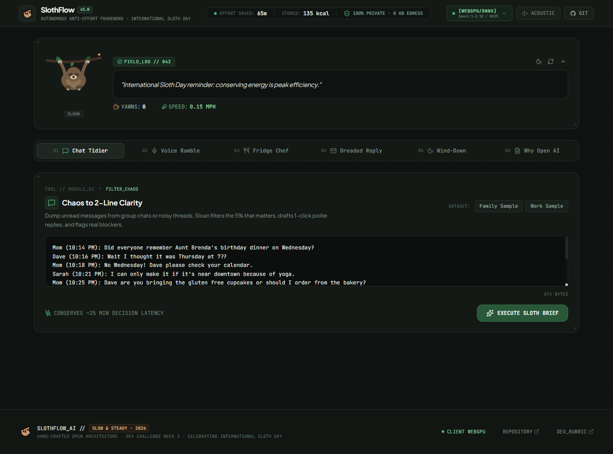
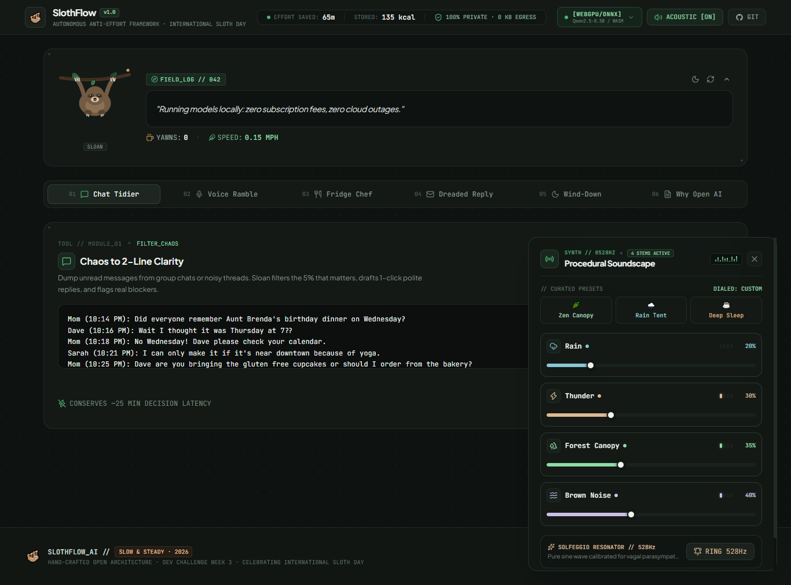
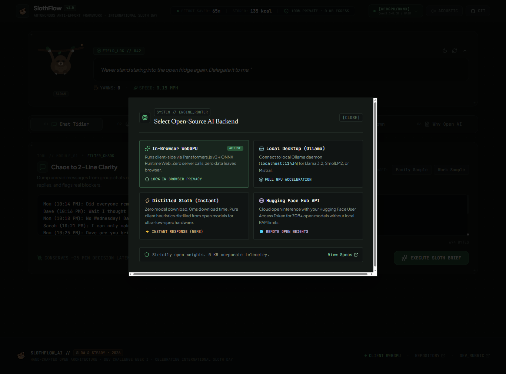

# 🦥 SlothFlow AI — Slow & Steady Open-Source AI That Rewards Laziness

[](https://slothflow-six.vercel.app)
[](https://dev.to/challenges/hacktoberfest-week3-2026-10-19)
[](https://opensource.org/licenses/MIT)
[-teal.svg)](#)
[](#)
[](#)

> 🚀 **Live Demo:** [https://slothflow-six.vercel.app](https://slothflow-six.vercel.app)
>
> **"Channel your inner sloth. Build something with open-source AI that does the work so you don't have to."**
> Built in honor of **International Sloth Day** and **Sloan the Sloth** (DEV's mascot).



---

## 🌟 Overview

**SlothFlow AI** is a client-first, zero-server-cost productivity and relaxation suite powered entirely by **open-weight models and local inference**. Instead of paying monthly API fees or piping private chats and audio rambles to remote servers, SlothFlow runs open models directly in your browser (via WebGPU & Transformers.js) or connects to your local desktop Ollama daemon.

It exists for one simple purpose: **to eliminate dreaded micro-tasks so you can conserve energy like a sloth.**

---

## 📸 Interface & Architecture Tour

### 1. Main Dashboard & Energy Telemetry
Clean cyber-terminal UI featuring live energy telemetry (effort saved, calories stored, 0 KB egress), Sloan mascot field log, and the **Chaos to 2-Line Clarity** group chat tidier.


### 2. Live Workspace & Procedural Soundscape Synth
Algorithmic soundscape generator built directly on the Web Audio API (Rain, Thunder, Forest Canopy, Brown Noise) with real-time LED meters and a Solfeggio 528Hz vagal parasympathetic resonator.


### 3. Open-Source Multi-Engine Inference Router
Unified router allowing users to toggle between In-Browser WebGPU (Transformers.js v3 + ONNX Runtime), Local Desktop (Ollama daemon on `localhost:11434`), Distilled Heuristics (50ms), and Hugging Face Hub API.


---

## 🦥 Core Features (The Laziness Suite)

### 1. 📱 Chaos to 2-Line Clarity (Chat & Inbox Tidier)
- Dump dozens of unread messages from noisy family group chats, Discord channels, or Slack threads.
- Open-weight model distills the chatter down to a **2-Line Sloth Brief** (what actually matters).
- Generates **Zero-Brainpower 1-Click Replies** (`"Sounds good to me!"`, `"Checking later tonight"`) and flags whether your input is actually required.

### 2. 🎙️ Lazy Voice Ramble to Clean Roadmap
- Lie down, click record, and mumble your half-asleep morning or bedtime thoughts.
- Cleanses incoherent speech streams into clean, prioritized bullet points and groceries.
- 1-click clipboard export.

### 3. 🍳 Fridge-to-Feast (No-Brain Cooking)
- Stop standing with the fridge door open staring blankly into the cold void.
- Enter whatever leftover scraps you see (e.g., *"2 eggs, stale bread crusts, cheddar slice, hot sauce"*).
- Sloth Chef devises a **3-step, 10-minute meal** requiring **1 pan, 1 fork, and zero knife prep**, complete with a humorous dishwashing-saving shortcut.

### 4. ✉️ The Procrastination Breaker (Dreaded Reply)
- Have an email or DM you've been delaying answering for 2 weeks because of social anxiety?
- Select your sloth defense strategy:
  - **Polite Delay**: Buys you 5 days of peace.
  - **Warm Decline**: Firm and polite, leaves no room for follow-ups.
  - **Ultra-Brief**: 12 words, zero mental burden.
  - **Enthusiastic Delegation**: Hands off the task smoothly.
- Generates an empathetic, guilt-free copy-paste reply instantly.

### 5. 💤 Wind-Down & Snooze Sanctuary
- **4-7-8 Sloth Breathing Guide**: Animated rhythmic breathing orb calibrated to Sloan's resting respiratory rate.
- **Tranquil Bedtime Micro-Stories**: Open models synthesize slow-cadence, hypnotic stories set in the misty cloud forest.
- **Offline Procedural Sound Engine**: Web Audio API synthesizes rain, thunder rumblings, forest night breeze, and warm brown noise with 0 network requests or MP3 files.

### 6. 🦥 Interactive Sloan Mascot & Laziness Meter
- Click Sloan to poke him, wake him up, or hear sloth wisdom.
- Real-time tracker for **Dreaded Minutes Eliminated**, **Calories Conserved**, and **Privacy Rating**.

---

## 🧠 Under the Hood: Why Open Innovation Matters

The challenge asked: *“Tell us where your open-based approach worked better than a closed one.”*

| Evaluation Criteria | Closed Proprietary Cloud APIs | SlothFlow AI (Open Innovation) |
|---|---|---|
| **Inference Cost** | Pay-per-token API meter ($$$/mo) | **$0.00 Forever** (Client WebGPU / Ollama) |
| **Data Privacy** | Ingested by remote server telemetry | **100% Private** (Never leaves your RAM) |
| **Offline Freedom** | Fails completely without internet | **Runs Offline** via Browser Cache & PWA |
| **Model Independence** | Vendor lock-in, forced deprecations | **Open Weights**: Qwen2.5, SmolLM, DistilBART, Llama |
| **Latency & Friction** | Cold starts, network latency, auth keys | **Instant Client Inference** |

---

## 🏗️ Architecture

```text
+--------------------------------------------------------------------------+
|                           CLIENT ENVIRONMENT                             |
|                                                                          |
|  +--------------------+   +---------------------+   +-----------------+  |
|  |  Chat Clutter Dump |   |  Voice Mumble Stream|   | Leftover Scraps |  |
|  +---------+----------+   +----------+----------+   +--------+--------+  |
|            |                         |                       |           |
|            v                         v                       v           |
|  +--------------------------------------------------------------------+  |
|  |                 SLOTHFLOW UNIFIED INFERENCE DISPATCHER             |  |
|  +------------------------------------+-------------------------------+  |
|                                       |                                  |
|         +-----------------------------+-----------------------------+    |
|         |                                                           |    |
|         v                                                           v    |
|  [ ENGINE A: WebGPU / WASM ]                             [ ENGINE B: Local ]  |
|  Transformers.js v3 Runtime                             Ollama Daemon    |
|  Models: Qwen2.5-0.5B / DistilBART                       Port: 11434      |
|  Cache: Browser Cache API                                Models: Llama 3.2|
|  Network: ZERO EXTERNAL REQUESTS                         SmolLM2 / Mistral|
|                                                                          |
|  +--------------------------------------------------------------------+  |
|  |               PROCEDURAL AUDIO SYNTHESIZER (Web Audio API)          |  |
|  |    Rain Simulator • Forest LFO Breeze • 528Hz Completion Chime    |  |
|  +--------------------------------------------------------------------+  |
+--------------------------------------------------------------------------+
```

---

## 🚀 Quickstart & Local Development

### Prerequisites
- Node.js >= 18.0.0
- npm >= 9.0.0

### Installation
```bash
# Clone the repository
git clone https://github.com/Dev-Suraj-Dhawal/slothflow.git
cd slothflow

# Install dependencies
npm install

# Start local development server
npm run dev
```

### Production Build
```bash
npm run build
npm run preview
```

---

## 🌐 Live Demo & Deployment

- **Live Demo:** [https://slothflow-six.vercel.app](https://slothflow-six.vercel.app)

SlothFlow AI is 100% static client-side ready and includes `vercel.json` optimized with Cross-Origin headers for WebGPU and WebAssembly.

```bash
npm i -g vercel
vercel deploy --prod
```

Or connect this repository directly in your [Vercel Dashboard](https://vercel.com/new).

---

## 📜 License

MIT License. Copyright (c) 2026 Suraj Dhawal. Free and open-source forever.

